# StudyFlow

FinTechathon 2026 International Track · Topic C (Cross-border & Student Finance Assistant) · Repository: <https://github.com/Ttttt12138/StudyFlow>

**A study-abroad finance assistant that starts with the price.** Look up whole-course costs, compare schools in THB, CNY or USD, then tell the Agent the amount to borrow. It recommends one loan plan, recalculates when monthly payments, interest or the amount concern you, and guides you to review and explicitly submit the simulated application. Submission attaches a simulated admission notice automatically and unlocks to-dos, bills and the wallet.

| Stage | Behavior |
| --- | --- |
| Price lookup and comparison | Whole-course totals and sources; saved school drafts |
| Loan selection | Agent recommendation from user-entered principal; concern-based recalculation, exact costs and explicit application review; full-course cap excluding fees |
| Application submitted | Automatic simulated notice and approval, remaining documents, explicit signing, school payouts and loan repayment; wallet/FX/remittance available |

The [shared student-flow contract](docs/student-loan-contract.md) defines interfaces, state migration and the deletion list. Family support, monthly bookkeeping, the standalone credit-record page, enrollment confirmation and the no-loan confirmation branch are removed from the student app; the on-time record itself still scales limits (see Credit building below).

> **All money is simulated.** There is no real bank, card or remittance rail. Pricing, permissions, limits, approvals and ledger constraints are nevertheless really enforced by the server.

### Submission materials

| Checklist item | Where |
|---|---|
| Technical documentation (architecture, core algorithms, security design) | [docs/technical-overview.md](docs/technical-overview.md) |
| Demo video (4:25) | [evidence/demo-current-live-20261015/StudyFlow_Demo_EN.mp4](evidence/demo-current-live-20261015/StudyFlow_Demo_EN.mp4) |
| Source code, deployment instructions and test cases | This README: [Quick start](#quick-start-docker-no-credentials-needed), [Local development](#local-development), [Testing](#testing) |
| Security self-assessment (permission tiers, known risks) | [docs/security-self-assessment.md](docs/security-self-assessment.md) |
| Execution evidence (simulated-account operation logs and demo video) | [evidence/demo-current-live-20261015/README.md](evidence/demo-current-live-20261015/README.md), [evidence index](evidence/README.md) |

---

## Platform capabilities

| Area | Highlights | Docs |
|---|---|---|
| Multi-currency wallet | THB home wallet plus foreign balances; one ledger entry point; balances can never go negative; ledger sum equals balance | [technical-overview §6](docs/technical-overview.md#6-ledger-invariants) |
| FX quoting | Reference rates from Frankfurter (central-bank blend) or fixtures; corridor fees and margins applied by the server; quotes are single-use and expire after 10 minutes | [§2](docs/technical-overview.md#2-server-side-fx-quoting) |
| Remittance | 9-state order machine; full refund on failure; idempotent payout callbacks; tuition is paid to verified payees | [§3](docs/technical-overview.md#3-remittance-order-state-machine) |
| Permissions | T0–T3 tiers, per-currency daily and monthly limits, password step-up, T3 approval by a different operator, rate limiting | [security-self-assessment](docs/security-self-assessment.md) |
| Credit building | Every loan installment paid on time, settled payment and on-time remittance counts toward a simulated on-time record (not a bureau score). Its level scales the student's outflow limits from 0.5× to 1.5× on the server, so repaying the study loan on time directly raises what the student can move | [technical-overview §5](docs/technical-overview.md#5-credit-level-and-limit-multiplier) |
| Historical platform services | Retired features (credit record, family support, budgets, bookkeeping, readiness) remain in the backend only, for existing contracts, demo gates and frozen evaluations; no entry in the app or operations console; deletion planned after the competition | [deletion boundary](docs/student-loan-contract.md#deletion-boundary) |
| AI agent | Tool-calling planner (LLM or rule-based) with runner-enforced guards: at most 10 steps and 4 writes; T2 tools only create proposals that expire after 15 minutes | [§7](docs/technical-overview.md#7-agent-loop-and-guardrails), [evaluation](docs/agent-evaluation.md) |
| Chinese and English | Localized API error messages with stable error codes | [§8](docs/technical-overview.md#8-internationalization) |

The repository holds three modules side by side: **A** `frontend/` (React student app, see [frontend setup](frontend/README.md)), **B** `backend/` (Django API) and **C** `studyflow-ai/` (AI package imported by B). The frontend signs in with the Django session; the API can also be exercised through Swagger UI and scripted HTTP demos.

## Architecture

One Django 5.2 + DRF server exposes everything under `/api/v2/` and stores it in PostgreSQL 17. The AI module `studyflow-ai/` is a Python package imported in-process, so it shares users, wallets, the ledger and database transactions with the API. Every write goes through a single command pipeline in one transaction: authentication → idempotency → user lock → policy (T2/T3) → handler → audit.



<sub>Diagram source: [architecture-overview.mmd](docs/diagrams/architecture-overview.mmd)</sub>

The full architecture, algorithms and diagrams are in [docs/technical-overview.md](docs/technical-overview.md).

## Quick start (Docker, no credentials needed)

Requires Docker with Compose v2.17+. Ports `8080`, `8000` and `55433` must be free (set `STUDYFLOW_WEB_PORT` to move `8080`).

```bash
docker compose up --build
```

| Service | Role |
|---|---|
| `db` | PostgreSQL 17 on `127.0.0.1:55433` (named volume `django_data`) |
| `app` | Django + gunicorn on `127.0.0.1:8000`; applies migrations, creates the rate-limit cache table and seeds demo users and data on start |
| `worker` | `readiness_worker --mode mock`, started once `app` is healthy |
| `web` | Built student app (`frontend/`) behind nginx on <http://localhost:8080>; `/api/`, `/admin/` and `/health/` are proxied to `app` on the same origin, and Django's static files are served for its login page |

Everything runs in **mock mode** with fixed FX rates, so nothing calls an external service.

1. **Get the demo logins.** `manage.py seed_demo` writes the student, operator and approver passwords and tokens inside the app container:
   ```bash
   docker compose exec app cat .demo-credentials.json
   ```
   The file lasts until the container is recreated (for example by a later `--build`); the users stay in the database. Set a new password with `docker compose exec app python manage.py changepassword demo-student`.
2. **Open the student app.** Go to <http://localhost:8080>, choose **Sign in to StudyFlow** and log in as `demo-student`; after signing in you return to the app. The interface opens in English; a 中文 switch is in the top bar.
3. **Browse the API.** Log in at <http://localhost:8080/api/auth/login/?next=/api/docs/> to open Swagger UI. `/api/docs/` requires login by design.
4. **Run a full remittance scenario over real HTTP.** It compares routes, pays tuition to a verified payee, refunds a failed transfer, routes a T3 approval through a second operator, and updates the on-time record that scales limits:
   ```bash
   docker compose exec app python manage.py demo_remittance --runs 1
   docker compose exec app python manage.py demo_agent --runs 1
   ```

Stop with `docker compose down`; add `-v` to also delete the database volume. For any shared deployment, set a real `DJANGO_SECRET_KEY`, and set `DJANGO_SECURE=true` behind HTTPS ([production settings](docs/permissions.md)).

## Local development

Python 3.11+ (3.13 is used in CI) and Docker for PostgreSQL.

The virtual environment lives at the repository root; Django commands run inside `backend/`.

```bash
python -m venv studyFlow
docker compose up -d --wait db    # database only, on 127.0.0.1:55433
cd backend
../studyFlow/Scripts/python.exe -m pip install -r requirements-dev.txt   # on macOS/Linux: ../studyFlow/bin/python
cp .env.example .env              # then set a random DJANGO_SECRET_KEY
../studyFlow/Scripts/python.exe manage.py migrate
../studyFlow/Scripts/python.exe manage.py createcachetable
../studyFlow/Scripts/python.exe manage.py seed_demo
../studyFlow/Scripts/python.exe manage.py runserver 127.0.0.1:8000
```

The student frontend then runs with `npm ci && npm run dev` in `frontend/` ([frontend setup](frontend/README.md)).

## Run modes

| Setting | Default | Effect | Needs |
|---|---|---|---|
| `STUDYFLOW_MODE` | `mock` | `mock`: rule-based agent planner and extractors. `live`: LLM gateway | `OPENAI_API_KEY`, `OPENAI_BASE_URL`, `OPENAI_MODEL` in `studyflow-ai/.env` (`TYPESAFE_API_KEY` is used only by the retired copilot) |
| `STUDYFLOW_FX_LIVE` | `false` | `true` fetches reference rates from Frankfurter | network access only |
| `STUDYFLOW_OCR_ENABLED` | `false` | Gemini OCR for scanned documents, with per-file consent | `GEMINI_API_KEY` plus two operator attestations ([gemini-ocr.md](docs/gemini-ocr.md)) |
| `DJANGO_SECURE` | `false` | HTTPS redirect, HSTS, secure cookies | an HTTPS deployment |

The live LLM and Gemini OCR need API credentials, and live FX needs only network access. The credentials are not in this public repository; the team provides them in the competition submission files sent by email (`.env` files for `backend/` and `studyflow-ai/`). The committed run logs also serve as evidence of the live results: [evidence/agent](evidence/agent/), [evidence/fx](evidence/fx/), [evidence/ocr](evidence/ocr/).

## Testing

One command runs all 17 gates: Django and C tests, migrations, OpenAPI validation, lint, six HTTP demos and the agent evaluation.

```bash
studyFlow/Scripts/python.exe scripts/run_gates.py
```

Current suites (2026-10-16), all passing: **Django 632 tests** (2 opt-in live recordings skipped), **C package 481 tests**, **frontend 81 unit and 54 mocked browser tests**. An earlier full 17-gate run is logged in [evidence/gates/](evidence/gates/). CI runs the same suites on every push ([django.yml](.github/workflows/django.yml), [c-module.yml](.github/workflows/c-module.yml)), plus the frontend build and browser suites ([frontend.yml](.github/workflows/frontend.yml)).

| Area | Test files | Test functions* | What they prove |
|---|---|---:|---|
| Permissions and limits | `backend/auto_test/test_policy.py`, `test_policy_concurrency.py` | 50 | Tier matrix, step-up token binding and single use, T3 approvals and separation of duties, Bangkok day and month windows, throttling, `check --deploy` |
| Remittance | `backend/auto_test/test_remittance.py`, `test_remittance_concurrency.py` | 59 | Every state transition, fee breakdowns, refunds, idempotent callbacks, no overdraw under concurrency |
| Multi-currency ledger | `backend/auto_test/test_multicurrency.py`, `test_multicurrency_concurrency.py` | 67 | Server-only pricing (client-rate exploit regression), single-use quotes, ledger sum equals balance, negative-balance constraint |
| Credit building (on-time record) | `backend/auto_test/test_credit.py` | 62 | Level rules, real-date window, anti-gaming, limit multiplier, immutable snapshots |
| Agent (Django runner) | `backend/auto_test/test_agent.py`, `test_agent_concurrency.py` | 56 | T2 never executes, step and write budgets, truncation, proposal expiry and confirmation, races |
| Agent (C planner) | `studyflow-ai/auto_test/test_agent_planner.py`, `test_agent_holdout.py` | 65 | Tool-call validation, live-output recovery, frozen holdout integrity |
| i18n | `backend/auto_test/test_i18n.py` | 9 | Localized messages and stable codes |
| OCR | `backend/auto_test/test_ocr_*.py`, `studyflow-ai/auto_test/test_document_ocr.py`, `test_ocr_config.py` | 37 | Consent gates, operator attestations, retry and fallback, injection cannot be confirmed, retention purge |
| Planning and loans | `backend/auto_test/test_planning*.py`, `test_loan_advice.py`, `test_lending_*.py`, `test_simplified_contract.py`, `studyflow-ai/auto_test/test_funnel.py`, `test_planning_rules.py` | — | Cost estimates, loan recommendation and recalculation, application, signing, school payouts, repayment |
| Retired modules (backend only) | `test_readiness_*.py`, `test_consumption_*.py`, `test_copilot*.py` and related `studyflow-ai/auto_test` files | the rest | Kept until the retired backend code is deleted after the competition |

\* Counted as `def test_` per file. Parametrized tests expand to more cases at run time.

## Key results

| Result | Value | Evidence |
|---|---|---|
| Live agent, **frozen holdout** (`agent-v2`, first run) | 18/24 tasks (75%), **0 unauthorized actions**, 1 of 4 injection cases partly followed (no money moved) | [agent-evaluation.md](docs/agent-evaluation.md) |
| Live FX pricing | 4 currency pairs, 12 route quotes matching the formula worked by hand | [evidence/fx](evidence/fx/verification-live-fx.json) |
| Gemini OCR, live | 6/6 synthetic samples; full HTTP → worker → OCR → extraction chain passed | [evidence/ocr](evidence/ocr/) |

The limitations behind these numbers are stated plainly in [docs/security-self-assessment.md §8](docs/security-self-assessment.md#8-known-risks) and [docs/agent-evaluation.md](docs/agent-evaluation.md#limitations). In particular, step-up is a password re-entry rather than a second factor, and the evaluation sets were written and reviewed by AI, not by humans.

## School data sources and terms

The ten schools in `backend/finance/planning/catalog/` are **sample data**. Each fee is a figure taken from a public page listed with its title and access date (most quotes are the figure itself), and the facility, food and place notes are the team's own one-line summaries. StudyFlow is not affiliated with or endorsed by these institutions, and rights in the cited pages stay with their owners; content is removed on request. UK figures contain public sector information licensed under the Open Government Licence v3.0; Australian visa figures are © Commonwealth of Australia (Department of Home Affairs), CC BY 3.0 AU. Details per source: [third-party licences](docs/third-party-licenses.md#school-data-and-visual-assets).

## Repository layout

| Path | Contents |
|---|---|
| `frontend/` | **A**: React + Vite student app and its browser suites ([setup](frontend/README.md)) |
| `frontend/Dockerfile`, `frontend/docker/` | Web image: built app on nginx, same-origin proxy to the API |
| `backend/` | **B**: Django project (`manage.py`, `requirements*.txt`, `.env.example`) |
| `backend/finance/` | Django app: wallets, FX, remittance, policy, credit, agent, lending, readiness, copilot |
| `backend/config/` | Django settings and URLs |
| `backend/auto_test/` | Django test suites |
| `backend/scripts/` | i18n catalog tool, fixture builders, live verification scripts, `start-backend` |
| `backend/Dockerfile`, `backend/docker/` | API image (built from the repository root because it includes C) |
| `backend/openapi.yaml` | Generated OpenAPI 3 contract |
| `studyflow-ai/` | **C**: AI module: agent planner, FX adapter, OCR, extraction, evaluation datasets (`evals/`) |
| `scripts/` | Cross-module gate runner, holdout freeze, PostgreSQL helpers |
| `compose.yaml` | One-command demo: database, API, readiness worker and web app |
| `evidence/` | Committed sandbox run logs and reports ([index](evidence/README.md)) |
| `docs/` | Technical overview, security self-assessment, evaluation, API guide (`docs/api/`), module notes |

## Documentation

- [Technical overview](docs/technical-overview.md): architecture, algorithms, guardrails
- [Security self-assessment](docs/security-self-assessment.md): permission tiers mapped to code and tests, plus known risks
- [Agent evaluation](docs/agent-evaluation.md): frozen holdout and tuning set reported separately
- [Evidence index](evidence/README.md): every run log and how to regenerate it
- [API guide](docs/api/guide.md), [API reference](docs/api/reference.md), [OpenAPI](backend/openapi.yaml)
- [Third-party components and licences](docs/third-party-licenses.md)

## Demo video

[**Watch the English demo (4:25)**](evidence/demo-current-live-20261015/StudyFlow_Demo_EN.mp4)

1080p with English narration and subtitles. Fifty-four shots follow the current journey: cost comparison, conversational loan recommendation, application and signing, reminders, tuition, currency exchange, remittance, repayment and independent operations approval. It was cut from one live browser acceptance run (19 live-AI user turns, 13 scenario checks, no rule or mock fallback). All financial transactions are simulated.

[English subtitles](evidence/demo-current-live-20261015/StudyFlow_Demo_EN.srt) · [Timed narration and reproduction](docs/demo-video-en.md) · [Recording evidence and operation logs](evidence/demo-current-live-20261015/README.md)
