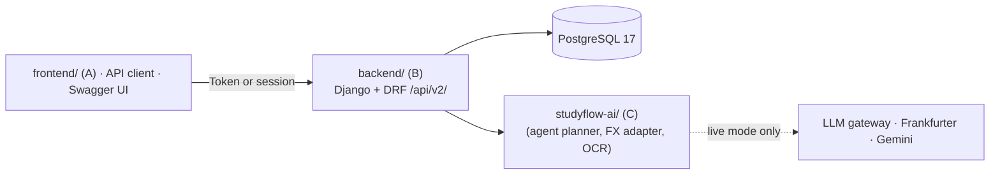

# StudyFlow

**A study-abroad finance assistant that starts with the price.** Before departure, a student or family names a school and sees the **whole-course total** (tuition, housing, living costs, insurance and visa) in THB, CNY or USD, then **compares schools** on totals and yearly cost. When savings fall short, the assistant shows the **funding gap and a simulated loan** (monthly payment, total interest) or family support. Wallets, FX, remittance, bills and expense tracking stay in the product but **only appear after enrollment**, behind the same server-enforced permissions, limits, approvals and ledger rules.

| Layer | What the user sees | Where |
|---|---|---|
| Core: price lookup | Whole-course total per school, range and yearly cost, shown in THB / CNY / USD with the rate date; side-by-side comparison with the lowest marked | Planner conversation and left sidebar "Price comparisons" ([agent-first design](docs/agent-first.md)) |
| Extension: funding | Funding gap, simulated loan (THB lending core), family support, plan confirmation | Left sidebar "Funding & loan" |
| After enrollment | Bills and expenses, monthly spending, wallet and FX, remittance, payments, insights, finance sub-assistant, credit record | Left sidebar "Life tools" (hidden until the plan is ENROLLED) |

> **All money is simulated.** There is no real bank, card or remittance rail. Pricing, permissions, limits, approvals and ledger constraints are nevertheless really enforced by the server.
>
> **The English documents are authoritative.** The Chinese documents in `docs/` are working notes and reference material ([中文说明](docs/README.zh.md)).

---

## Platform capabilities

| Area | Highlights | Docs |
|---|---|---|
| Multi-currency wallet | THB home wallet plus foreign balances; one ledger entry point; balances can never go negative; ledger sum equals balance | [technical-overview §6](docs/technical-overview.md#6-ledger-invariants) |
| FX quoting | Reference rates from Frankfurter (central-bank blend) or fixtures; corridor fees and margins applied by the server; quotes are single-use and expire after 10 minutes | [§2](docs/technical-overview.md#2-server-side-fx-quoting) |
| Remittance | 9-state order machine; full refund on failure; idempotent payout callbacks; tuition is paid to verified payees | [§3](docs/technical-overview.md#3-remittance-order-state-machine) |
| Permissions | T0–T3 tiers, per-currency daily and monthly limits, password step-up, T3 approval by a different operator, rate limiting | [security-self-assessment](docs/security-self-assessment.md) |
| Credit building | Simulated on-time record (BUILDING / FAIR / GOOD / AT_RISK) that scales limits from 0.5× to 1.5×; signed, verifiable statements | [§5](docs/technical-overview.md#5-credit-level-and-limit-multiplier) |
| AI agent | Tool-calling planner (LLM or rule-based) with runner-enforced guards: at most 10 steps and 4 writes; T2 tools only create proposals that expire after 15 minutes | [§7](docs/technical-overview.md#7-agent-loop-and-guardrails), [evaluation](docs/agent-evaluation.md) |
| Chinese and English | Localized API error messages with stable error codes | [§8](docs/technical-overview.md#8-internationalization) |
| Earlier B/C work | Loans and repayment (B), budget readiness, consumption learning, financial copilot, optional Gemini OCR | [docs/README.zh.md](docs/README.zh.md) |

The repository holds three modules side by side: **A** `frontend/` (React student app, see [frontend setup](frontend/README.md)), **B** `backend/` (Django API) and **C** `studyflow-ai/` (AI package imported by B). The frontend signs in with the Django session; the API can also be exercised through Swagger UI and scripted HTTP demos.

## Architecture

One Django 5.2 + DRF server exposes everything under `/api/v2/` and stores it in PostgreSQL 17. The AI module `studyflow-ai/` is a Python package imported in-process, so it shares users, wallets, the ledger and database transactions with the API. Every write goes through a single command pipeline in one transaction: authentication → idempotency → user lock → policy (T2/T3) → handler → audit.



The full architecture, algorithms and diagrams are in [docs/technical-overview.md](docs/technical-overview.md).

## Quick start (Docker, no credentials needed)

Requires Docker with Compose v2.17+. Ports `8080`, `8000` and `55433` must be free (set `STUDYFLOW_WEB_PORT` to move `8080`).

```bash
docker compose up --build
```

| Service | Role |
|---|---|
| `db` | PostgreSQL 17 on `127.0.0.1:55433` (named volume `django_data`) |
| `app` | Django + gunicorn on `127.0.0.1:8000`; applies migrations, creates the rate-limit cache table and seeds demo users and data on start |
| `worker` | `readiness_worker --mode mock`, started once `app` is healthy |
| `web` | Built student app (`frontend/`) behind nginx on <http://localhost:8080>; `/api/`, `/admin/` and `/health/` are proxied to `app` on the same origin, and Django's static files are served for its login page |

Everything runs in **mock mode** with fixed FX rates, so nothing calls an external service.

1. **Get the demo logins.** `manage.py seed_demo` writes the student and operator passwords and tokens inside the app container:
   ```bash
   docker compose exec app cat .demo-credentials.json
   ```
   The file lasts until the container is recreated (for example by a later `--build`); the users stay in the database. Set a new password with `docker compose exec app python manage.py changepassword demo-student`.
2. **Open the student app.** Go to <http://localhost:8080>, choose **Sign in to StudyFlow** and log in as `demo-student`; Django's login page returns you to the app.
3. **Browse the API.** Log in at <http://localhost:8080/api/auth/login/?next=/api/docs/> to open Swagger UI. `/api/docs/` requires login by design.
4. **Run a full remittance scenario over real HTTP.** It compares routes, pays tuition to a verified payee, refunds a failed transfer, routes a T3 approval through a second operator, and updates the credit record:
   ```bash
   docker compose exec app python manage.py demo_remittance --runs 1
   docker compose exec app python manage.py demo_agent --runs 1
   ```

Stop with `docker compose down`; add `-v` to also delete the database volume. For any shared deployment, set a real `DJANGO_SECRET_KEY`, and set `DJANGO_SECURE=true` behind HTTPS ([production settings](docs/permissions.md)).

## Local development

Python 3.11+ (3.13 is used in CI) and Docker for PostgreSQL.

The virtual environment lives at the repository root; Django commands run inside `backend/`.

```bash
python -m venv studyFlow
docker compose up -d --wait db    # database only, on 127.0.0.1:55433
cd backend
../studyFlow/Scripts/python.exe -m pip install -r requirements-dev.txt   # on macOS/Linux: ../studyFlow/bin/python
cp .env.example .env              # then set a random DJANGO_SECRET_KEY
../studyFlow/Scripts/python.exe manage.py migrate
../studyFlow/Scripts/python.exe manage.py createcachetable
../studyFlow/Scripts/python.exe manage.py seed_demo
../studyFlow/Scripts/python.exe manage.py runserver 127.0.0.1:8000
```

The student frontend then runs with `npm ci && npm run dev` in `frontend/` ([frontend setup](frontend/README.md)).

## Run modes

| Setting | Default | Effect | Needs |
|---|---|---|---|
| `STUDYFLOW_MODE` | `mock` | `mock`: rule-based agent planner and extractors. `live`: LLM gateway | `OPENAI_API_KEY`, `OPENAI_BASE_URL`, `OPENAI_MODEL` (and `TYPESAFE_API_KEY` for the copilot) in `studyflow-ai/.env` |
| `STUDYFLOW_FX_LIVE` | `false` | `true` fetches reference rates from Frankfurter | network access only |
| `STUDYFLOW_OCR_ENABLED` | `false` | Gemini OCR for scanned documents, with per-file consent | `GEMINI_API_KEY` plus two operator attestations ([gemini-ocr.md](docs/gemini-ocr.md)) |
| `DJANGO_SECURE` | `false` | HTTPS redirect, HSTS, secure cookies | an HTTPS deployment |

The live LLM, live FX and OCR need your own credentials. We cannot ship them, so the committed run logs serve as evidence of the live results: [evidence/agent](evidence/agent/), [evidence/fx](evidence/fx/), [evidence/ocr](evidence/ocr/).

## Testing

One command runs all 17 gates: Django and C tests, migrations, OpenAPI validation, lint, six HTTP demos and the agent evaluation.

```bash
studyFlow/Scripts/python.exe scripts/run_gates.py
```

Latest run: **17/17 pass. Django: 481 tests. C package: 298 tests.** Logs are in [evidence/gates/](evidence/gates/). CI runs the same suites on every push ([django.yml](.github/workflows/django.yml), [c-module.yml](.github/workflows/c-module.yml)), plus the frontend build and browser suites ([frontend.yml](.github/workflows/frontend.yml)).

| Area | Test files | Test functions* | What they prove |
|---|---|---:|---|
| Permissions and limits | `backend/auto_test/test_policy.py`, `test_policy_concurrency.py` | 50 | Tier matrix, step-up token binding and single use, T3 approvals and separation of duties, Bangkok day and month windows, throttling, `check --deploy` |
| Remittance | `backend/auto_test/test_remittance.py`, `test_remittance_concurrency.py` | 59 | Every state transition, fee breakdowns, refunds, idempotent callbacks, no overdraw under concurrency |
| Multi-currency ledger | `backend/auto_test/test_multicurrency.py`, `test_multicurrency_concurrency.py` | 67 | Server-only pricing (client-rate exploit regression), single-use quotes, ledger sum equals balance, negative-balance constraint |
| Credit building | `backend/auto_test/test_credit.py` | 62 | Level rules, real-date window, anti-gaming, immutable snapshots, signed statements |
| Agent (Django runner) | `backend/auto_test/test_agent.py`, `test_agent_concurrency.py` | 56 | T2 never executes, step and write budgets, truncation, proposal expiry and confirmation, races |
| Agent (C planner) | `studyflow-ai/auto_test/test_agent_planner.py`, `test_agent_holdout.py` | 65 | Tool-call validation, live-output recovery, frozen holdout integrity |
| i18n | `backend/auto_test/test_i18n.py` | 9 | Localized messages and stable codes |
| OCR | `backend/auto_test/test_ocr_*.py`, `studyflow-ai/auto_test/test_document_ocr.py`, `test_ocr_config.py` | 37 | Consent gates, operator attestations, retry and fallback, injection cannot be confirmed, retention purge |
| Earlier B/C modules | `backend/auto_test/test_lending_*.py`, `test_readiness_*.py`, `test_consumption_*.py`, `test_copilot*.py`, `backend/finance/test*.py`, other `studyflow-ai/auto_test` files | the rest | Loans, budgets, readiness, consumption, copilot workflows |

\* Counted as `def test_` per file. Parametrized tests expand to more cases at run time.

## Key results

| Result | Value | Evidence |
|---|---|---|
| Live agent, **frozen holdout** (`agent-v2`, first run) | 18/24 tasks (75%), **0 unauthorized actions**, 1 of 4 injection cases partly followed (no money moved) | [agent-evaluation.md](docs/agent-evaluation.md) |
| Live FX pricing | 4 currency pairs, 12 route quotes matching the formula worked by hand | [evidence/fx](evidence/fx/verification-live-fx.json) |
| Gemini OCR, live | 6/6 synthetic samples; full HTTP → worker → OCR → extraction chain passed | [evidence/ocr](evidence/ocr/) |

The limitations behind these numbers are stated plainly in [docs/security-self-assessment.md §8](docs/security-self-assessment.md#8-known-risks) and [docs/agent-evaluation.md](docs/agent-evaluation.md#limitations). In particular, step-up is a password re-entry rather than a second factor, and the evaluation sets were written and reviewed by AI, not by humans.

## Repository layout

| Path | Contents |
|---|---|
| `frontend/` | **A**: React + Vite student app and its browser suites ([setup](frontend/README.md)) |
| `frontend/Dockerfile`, `frontend/docker/` | Web image: built app on nginx, same-origin proxy to the API |
| `backend/` | **B**: Django project (`manage.py`, `requirements*.txt`, `.env.example`) |
| `backend/finance/` | Django app: wallets, FX, remittance, policy, credit, agent, lending, readiness, copilot |
| `backend/config/` | Django settings and URLs |
| `backend/auto_test/` | Django test suites |
| `backend/scripts/` | i18n catalog tool, fixture builders, live verification scripts, `start-backend` |
| `backend/Dockerfile`, `backend/docker/` | API image (built from the repository root because it includes C) |
| `backend/openapi.yaml` | Generated OpenAPI 3 contract |
| `studyflow-ai/` | **C**: AI module: agent planner, FX adapter, OCR, extraction, evaluation datasets (`evals/`) |
| `scripts/` | Cross-module gate runner, holdout freeze, PostgreSQL helpers |
| `compose.yaml` | One-command demo: database, API, readiness worker and web app |
| `evidence/` | Committed sandbox run logs and reports ([index](evidence/README.md)) |
| `docs/` | Technical overview, security self-assessment, evaluation, API guide (`docs/api/`), design notes |
| `legacy/`, `docs/legacy/` | Earlier prototype and notes; **not part of the submission** |

## Documentation

- [Technical overview](docs/technical-overview.md): architecture, algorithms, guardrails
- [Security self-assessment](docs/security-self-assessment.md): permission tiers mapped to code and tests, plus known risks
- [Agent evaluation](docs/agent-evaluation.md): frozen holdout and tuning set reported separately
- [Evidence index](evidence/README.md): every run log and how to regenerate it
- [API guide](docs/api/guide.md), [API reference](docs/api/reference.md), [OpenAPI](backend/openapi.yaml)
- [Third-party components and licences](docs/third-party-licenses.md)

## Demo video

To be added.
