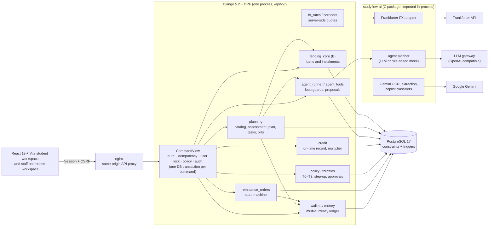
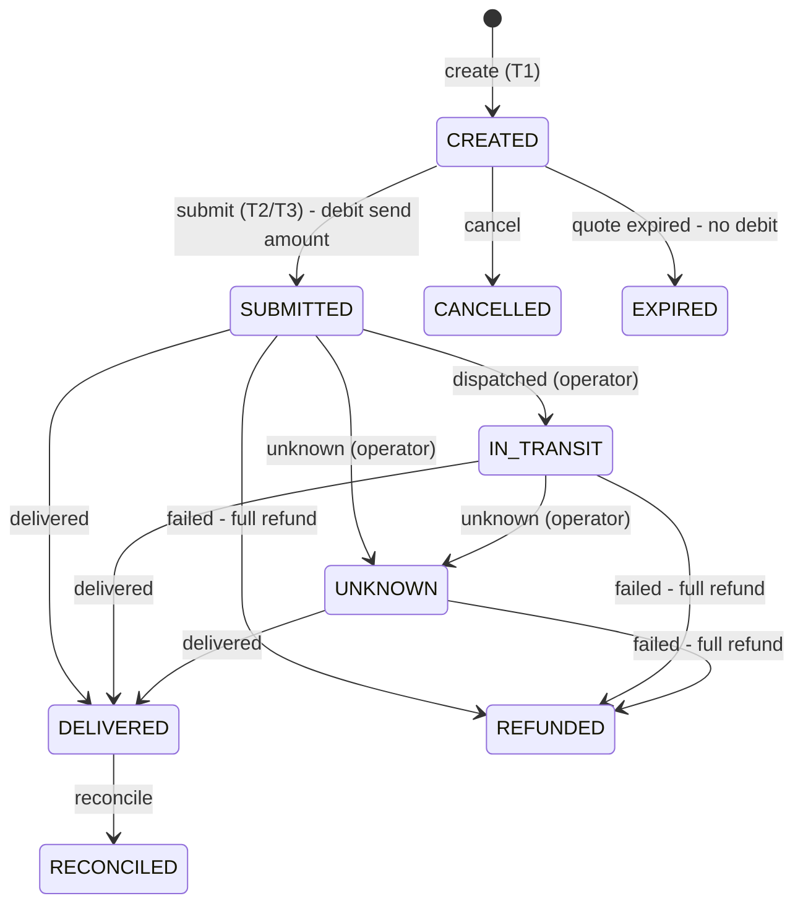
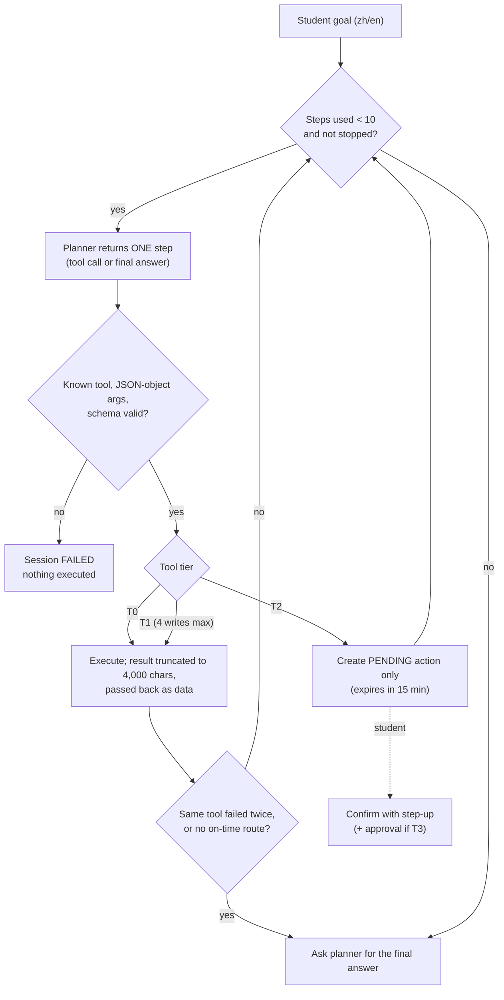

# Technical Overview

StudyFlow helps students and families compare the cost of studying abroad, identify a funding gap, and choose a simulated funding plan. The main conversation starts with full-course prices and school comparisons. A confirmed plan adds preparation tasks and bills; enrollment opens spending records and wallet tools. **All money and lending are simulated.** School prices are sourced sample estimates, not school invoices or binding quotations. The server enforces permissions, limits, approvals and ledger constraints.

Updated 2026-10-14 for Topic C, including the React frontend, current planning and loan lifecycle, wallet bill payments and post-enrollment tools. Security is covered in [security-self-assessment.md](security-self-assessment.md); historical agent evaluation in [agent-evaluation.md](agent-evaluation.md). Implementation paths describe the current code; dated evidence identifies what was actually exercised.

---

## 1. Architecture

- **One application backend.** Django 5.2 + DRF serves `/api/v2/`; PostgreSQL 17 stores authoritative state. The C module is imported in-process. Compose runs nginx, Django, PostgreSQL and a separate readiness worker using the same application and database. The worker is required for background readiness jobs.
- **Mock vs live.** Two independent switches control external calls. Both default to offline, so everything runs with no keys:
  - `STUDYFLOW_MODE=mock` uses rule-based planners and extractors; `live` calls the LLM gateway.
  - `STUDYFLOW_FX_LIVE=false` uses fixed FX rates; `true` calls Frankfurter.

  Gemini OCR is a third opt-in that is off by default. It needs operator attestations and per-file consent.
- **Financial commands go through `CommandView`** (`backend/finance/workflow_api.py`). In one database transaction it:
  1. authenticates the caller;
  2. checks the `Idempotency-Key` (a replay returns the stored response);
  3. takes a row lock on the user;
  4. runs the policy check for T2/T3 routes;
  5. runs the handler;
  6. writes an audit event.

  Any failure rolls back everything, including step-up token use.

  Conversation creation, messages, school selection, profile updates and authentication have their own API views. They are not all instances of `CommandView`; tools still use server validation and transactions. Session-changing authentication requires CSRF. External AI credentials stay server-side.

### 1.1 Planning and cost calculation

The plan progresses through `DRAFT`, `CONFIRMED` and `ENROLLED`. Confirmation creates estimated bills and a destination-specific checklist. The start date alone never confirms enrollment. The main conversation remains mounted while contextual panels open; phone layouts show one tool at a time. Sidebar visibility is a presentation rule. Planning prompts and rules defer wallet tools until enrollment; expense recording checks enrollment server-side. Legacy money tools/APIs retain authentication and monetary policy but do not all enforce the plan stage (security risk P4).

Ten entries in `backend/finance/planning/catalog/` include bilingual descriptions, public source URLs, observation dates, billing periods and cost status. `planning/costs.py` expands one-off, monthly, yearly and semester fees over actual course duration, including half years and year-specific rates. Missing amounts remain missing. An incomplete result is a known subtotal and cannot win the lowest-total ranking. Conversion includes rate provenance; course totals, 30/60/90-day forecasts and loan repayment terms remain separate quantities.

`PlanningAssessment` stores versioned declared funds, personal cost adjustments and results separately from the wallet and financial state. Declaring savings does not credit a wallet. Unreceived support affects only a conditional forecast. `planning/assessment/` returns the chosen quote and lifecycle; `planning/loan-preview/` calculates without persisting a quote. School selection and assessment preserve up to three drafts. Signing prevents changing the underlying school or plan; changing school beforehand withdraws unsigned applications.

### 1.2 Simulated study loan lifecycle

The pre-check sizes a loan from the full-course funding gap converted to THB, plus fees. It does **not** assess repayment affordability or verify income. Borrower choice changes checklist wording; it does not create a legally verified co-borrower. Products are `custom` (default 6%, 24/36/48 months) and `commercial_student_demo` (4.5%, 24/36/48/60 months). These are demonstration terms, not lender offers.

`lending_core/calculations.py` uses decimal money calculations and produces the authoritative schedule. Amortized payments repay principal and interest from the start. The commercial sample also offers interest-only payments during study, followed by the selected amortization term. The interest-only period counts repayment dates before course completion, capped at 72 months, and is added to the selected 24-60 months. Deferring principal raises total interest. A 20,000 THB example at 4.5% pays 75.00 THB per interest-only month; later payments and rounding come from the schedule.

`planning/plan/confirm/` confirms the plan and submits at most one active simulated application in one command. Planning approval checks the pre-check ceiling and a future first repayment date, rather than the generic monthly-income workflow. Quote affordability is therefore `assessment.status=NOT_ASSESSED`. The user marks admission, identity and borrower/co-borrower income checklist items, then explicitly signs through `planning/loan/sign/`.

Signing creates a loan account and school-directed disbursement without crediting the student's wallet. `planning/loan_stage.py` allocates net proceeds to tuition first, then other bills by due date. Partial coverage splits a bill into loan-funded and family-funded portions, using signing-time reference FX. Scheduled payouts mark covered bills paid when the simulated date reaches their due dates. They are simulation records, not bank transfers or school receipts. Unallocated proceeds are audited. Operator wallet disbursement is refused for these loans. Repayment follows the signed schedule and existing password step-up, limits, version and idempotency controls.

### 1.3 Enrollment and daily money tools

This month groups tasks, upcoming payments, monthly spending and expenses. Reminder changes do not alter original contract or bill dates; completing a task does not repay a loan. Reminders refresh while the app is open and send no email or system push. Budget and expense records do not themselves move funds.

After enrollment, Wallet and payments groups balances, conversion, remittance, school bills and history. `planning/bills/{id}/pay-from-wallet/` deducts the bill currency through `wallets.post`, under `bill.pay`, with password step-up and T3 approval when above a limit. Loan-funded bills cannot be paid again. Owner-only `demo/wallets/top-up/` creates simulated money and a funding-source ledger entry, capped at 1,000,000 per request; it is not a bank deposit. The fixed simulated 2,000 CNY-equivalent planning credit facility is distinct from the payment-record multiplier in section 5. A bill paid with it is owed back within 30 days through `planning/credit/charges/{id}/repay/` under `credit.repay`: the THB amount leaves the wallet through `wallets.post` (ledger origin `credit_charge`) after a password step-up. Ticking the reminder off is refused, so a repayment is never only a declaration.

### Directory map

| Path | Contents |
|---|---|
| `frontend/` | A: React + Vite student app and browser suites |
| `backend/` | B: Django project root (`manage.py`, requirements, Dockerfile) |
| `backend/finance/` | Django app: planning, wallets, FX, remittance, policy, credit, agent, lending, readiness, copilot, consumption |
| `backend/finance/planning/` | Catalog, cost calculation, assessment, drafts, loan signing/payouts, tasks and bill payments |
| `backend/finance/lending_core/` | B's pure loan calculations and contracts |
| `studyflow-ai/` | C package: agent planner and prompts, FX adapter, OCR, extraction, evaluation sets (`evals/`) |
| `backend/config/` | Django settings, URLs, OpenAPI schema hooks |
| `backend/auto_test/` | Django tests, concurrency suites and opt-in isolated browser acceptance |
| `studyflow-ai/auto_test/` | C package tests |
| `scripts/` | `run_gates.py` (all checks across A/B/C), holdout freeze, PostgreSQL helpers |
| `backend/scripts/` | i18n catalog tool, fixture builders, live verification scripts |
| `evidence/` | Committed run logs and reports ([index](../evidence/README.md)) |
| `docs/` | Design and verification documents; `docs/api/` holds the API guide and reference |
| `legacy/`, `docs/legacy/` | Earlier prototype and notes; not part of the submission |

---

## 2. Server-side FX quoting

The client never supplies a rate. A quote is priced by the server from a corridor and a reference rate (`backend/finance/fx_rates.py` `create_live_quote`).

1. **Reference (mid) rate.** The mid rate comes from Frankfurter, through the C adapter, which blends central-bank reference rates (ECB, Bank of Thailand, CFETS and others). In mock mode it comes from fixed fixtures. Snapshots are cached for 15 minutes. On a fetch failure the last snapshot is used, but a rate older than **7 days** is refused (`STALE_FX_RATE`). In live mode, fixture rates are never executable.
2. **Corridor.** There are 12 corridors (`backend/finance/corridors.py`): CNY, USD and EUR → THB, and THB → CNY, each with express, standard and economy tiers. Each tier has a fixed fee, a percentage fee, an FX margin, min/max amounts and settlement days.
3. **Customer rate** = `mid × (1 − margin_bps / 10000)`, rounded **down** to 10 decimal places.
4. **Sender fee** = `fee_fixed + amount × fee_percent`, rounded half-up to the source currency's precision.
5. **Net received** = `(amount − sender_fee) × rate − receiver_fee`, rounded half-up to the target precision. Live quotes have a receiver fee of 0.
6. A quote is **valid for 10 minutes and can be used once**. It can only be used by its owner, and only for the amount it was priced for. Conversion and remittance both re-check that the corridor is still enabled and the amount is within range.

Example (live, 2026-10-07): CNY→THB express, 1,000 CNY, mid 5.0187, margin 60 bps, fee 30 + 0.5%.
- Fee = 30 + 1,000 × 0.005 = **35 CNY**
- Rate = 5.0187 × 0.994 = **4.98859 THB/CNY**
- Received = (1,000 − 35) × 4.98859 = **4,813.99 THB**

All 12 routes were checked by hand against live rates ([evidence/fx](../evidence/fx/verification-live-fx.json)).

A security review found that a client-entered rate could once be used to create money from nothing; this was fixed, and `test_manual_quote_exploit_is_rejected` guards against regression.

## 3. Remittance order state machine

Source: `TRANSITIONS` in `backend/finance/remittance_orders.py`.
- Each transition checks the order's version and appends one row to an immutable status history (a database trigger blocks updates and deletes).
- **Money legs:**
  - `submit` debits the send amount from the source balance. For a THB source, the wallet must keep the student's reserve (`RESERVE_REQUIRED`).
  - `failed` refunds the full send amount and records a reason.
  - `delivered` credits the received amount to the student's own wallet when `recipient=SELF`; a payment to a beneficiary leaves the wallet untouched.

  The database allows **at most one leg of each kind per order** and enforces the sign of each leg.
- **Beneficiaries.** `recipient=BENEFICIARY` requires a verified payee, checked both when the order is created and again when it is submitted.
- **Callbacks** (`dispatched` / `delivered` / `failed` / `unknown`) are operator-only. Each is idempotent, so a duplicate callback is acknowledged without a second posting, and conflicting callbacks settle one way only.
- `REFUNDED` and `UNKNOWN` orders appear in the review queue. Delivered orders with a deadline, paid to a verified beneficiary, feed the credit record.

Tuition can be a plan bill, covered by a signed planning loan or paid from the wallet or the credit line. Each plan has a school payee (`StudyPlan.school_payee`, `backend/finance/planning/payees.py`): a `Beneficiary` the student owns, created from the school's seeded tuition account, which is marked verified. Money to the school requires it to be verified at the moment it moves: signing the loan, every loan payout (an unverified account leaves the tranche `SCHEDULED` and the bill due), and paying a tuition bill from the wallet or credit line (`SCHOOL_PAYEE_NOT_VERIFIED`). Operators can revoke or restore it through `beneficiaries/{id}/verify/`. Housing, insurance and visa bills paid by the student may go to third parties and are not checked. Legacy remittance supports `purpose=tuition` to a verified payee; readiness supports a confirmed invoice ([consumption.md](consumption.md)). The seeded accounts are simulated, and catalog bills and loan payouts do not constitute school-side invoice verification or confirmation of receipt.

## 4. Tiered permissions and limits (summary)

| Tier | Example | Requirement |
|---|---|---|
| T0 | any `GET` | logged in, own data only |
| T1 | quote, create order, request approval | owner |
| T2 | submit payment or remittance, convert, repay, within limits | **step-up**: password re-entry gives a token valid 5 minutes, single-use, bound to action, target, amount and currency |
| T3 | a T2 action above the per-transaction, daily or monthly limit | step-up **plus** approval by a different operator (separation of duties) |

Limits are kept per currency in the `PolicyLimit` table and multiplied by the credit multiplier (§5). Days and months follow real time in Bangkok. The check runs inside the command's transaction under the user lock, so concurrent requests cannot exceed a limit. The full control-by-control mapping to code and tests is in [security-self-assessment.md](security-self-assessment.md).

## 5. Credit level and limit multiplier

Source: `backend/finance/credit.py`. The credit level is a simulated on-time record, not a credit score.

- **Evidence counted:**
  - loan instalments;
  - settled bill payments;
  - delivered remittance orders that have a deadline and go to a **verified** beneficiary;
  - plan bills paid from the wallet (not those marked paid by hand or paid by the loan), compared by the demo date paid; a bill due more than a year after it was paid does not count;
  - pay-later charges repaid from the wallet (on time or late), or still unpaid past their 30-day due date (overdue).

  Self-transfers never count, so the level cannot be inflated cheaply.
- **Window.** Only the last **365 days** count, measured in **real** dates. Moving the demo clock forward can only make obligations overdue sooner; it can never age a late record out. Unresolved overdue items never age out.
- **Levels and multipliers:**

| Level | Rule (first match) | Limit multiplier |
|---|---|---:|
| AT_RISK | any overdue item, or 2 or more late records | 0.5 |
| GOOD | 6 or more on time and 0 late | 1.5 |
| FAIR | 3 or more on time and at most 1 late | 1.2 |
| BUILDING | otherwise | 1.0 |

- Snapshots are immutable. A signed statement (`django.core.signing`, valid 90 days) contains only summary fields, and anyone can verify it without logging in.

## 6. Ledger invariants

Source: `backend/finance/wallets.py`, migrations `0015`–`0017`.

1. **One entry point.** Every balance change goes through `wallets.post()`. It locks the user row and the balance row, assigns a per-owner sequence number and writes one ledger entry.
2. **Non-negative balances.** A database `CHECK` constraint enforces this for both the home (THB) wallet and foreign `WalletBalance` rows.
3. **Ledger equals balance.** For each currency, the sum of ledger entries equals the balance. Randomized and mixed-sequence tests check this after every step.
4. **Immutability.** Ledger entries, conversions, remittance status history and agent steps cannot be updated or deleted.
5. **Exactly-once effects.** Idempotency keys, single-use quotes and step-up tokens, and per-order leg constraints mean that a retried or racing request never posts twice. Concurrency suites (`backend/auto_test/test_*_concurrency.py`) run real parallel requests against PostgreSQL.

## 7. Agent loop and guardrails

Source: `backend/finance/agent_runner.py`, `backend/finance/agent_tools.py`, `studyflow-ai/src/studyflow_ai/agent/`.

| Guard | Value | Enforced by |
|---|---|---|
| Tool calls per session | 10 | `MAX_STEPS` |
| T1 writes per session | 4 | `MAX_WRITES` |
| Tool result size passed to the planner | 4,000 characters (`{"truncated": true, …}`) | `RESULT_CHARS` |
| Consecutive failures of the same tool | stop after 2 | `_must_stop` |
| Proposal lifetime | 15 minutes | `PENDING_SECONDS` |
| T2 execution by the agent | **none**: it can only propose | `_propose`; `confirm_pending` runs only for the student, under policy `agent.confirm` |
| Sessions per user | 30 per hour | `agent` throttle |

The finance prompt is `agent-1.3`; the main conversation uses `planning-1.9`. Each message becomes an audited `AgentSession`, with up to 12 history messages and server memory containing the plan, catalog and pre-check. The runner refreshes `memory.server_time` on every step for real-time quote/proposal expiry, separately from the simulated study date in `memory.today`. Greetings, card-button school selection and date-driven enrollment proposals are deterministic system turns. Opening the loan panel does not submit an application. Plan confirmation and enrollment require explicit confirmation; monetary proposals additionally require the underlying authorization. Prompts treat tool/document content as untrusted data. Authorization and exact calculations do not depend on model compliance. Live failure never falls back to the rule provider.

## 8. Internationalization

API error responses carry a stable `code` and a localized `message` in Chinese or English, negotiated from `Accept-Language`. A CI gate checks that the message catalogs are complete and compiled. The translations were produced by AI and have not yet been reviewed by a native speaker (risk M7).

## 9. Verification

| Check | Command or evidence | Recorded result and boundary |
|---|---|---|
| Updated full-flow live acceptance | [Full recording and evidence](../evidence/demo-full-live-20261014/README.md) | 12 completed live turns, 43 decisions / 51 provider attempts, 16 feature checks; updated credit wallet repayment; retained take-07 footage re-edited into a 4:05 Ava-narrated film; one existing-enrollment-proposal guard, simulated funds |
| Historical complete gates | `python scripts/run_gates.py` | 17/17 on 2026-10-07 ([evidence/gates](../evidence/gates/summary.txt)); not acceptance of later changes |
| Simplified planning | [2026-10-13 record](../evidence/short-planning-20261013/verification.json) | 121 focused backend tests, 165 frontend units, 23 rule tests, five offline browser cases; dated results |
| Current loan/browser journey | [2026-10-14 record](../evidence/short-planning-20261014/browser.json) | English desktop and Chinese phone: signing, school payout and repayment; real local HTTP/PostgreSQL, rule planner, simulated funds |
| Earlier planning-only live acceptance | [2026-10-14 live acceptance](verification-planning-live-20261014.md) | Two browser journeys, eight live user turns and fifteen recorded live planner calls; explicit user signing/repayment; simulated money |
| Earlier focused safeguards | [Baseline log](../evidence/planning-live-20261014/backend-baseline.log) | 155 related backend/browser checks passed before live acceptance |
| Live FX pricing | see [verification-live-20261007.md](verification-live-20261007.md) | 4 pairs, 12 quotes match the formula |
| Live agent, frozen holdout | see [agent-evaluation.md](agent-evaluation.md) | 18/24, 0 unauthorized actions |
| CI | `.github/workflows/django.yml`, `c-module.yml` | runs on every push and pull request |

The holdout files `studyflow-ai/evals/copilot-holdout-v2/{manifest,protocol,review}.json` were hashed from a Windows checkout with CRLF line endings, but git stores them with LF. Their SHA-256 in `docs/independent-verification-summary.json` therefore matches the CRLF form. The project's own check (`test_blind_protocol_records_exact_runtime_code`) accepts the raw, LF and CRLF forms; a plain byte comparison on a Linux checkout will not match.
