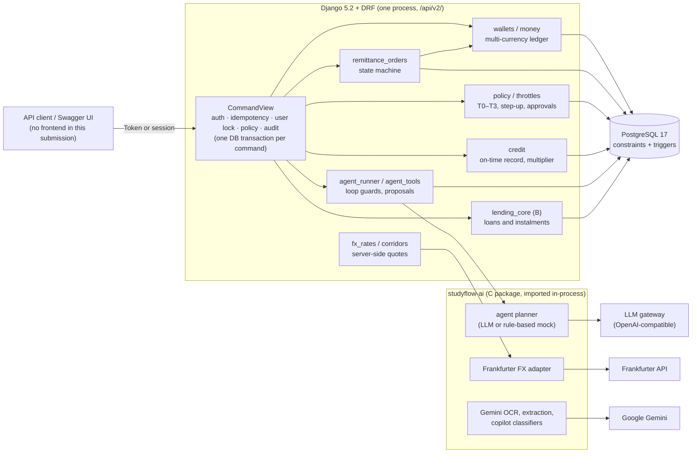
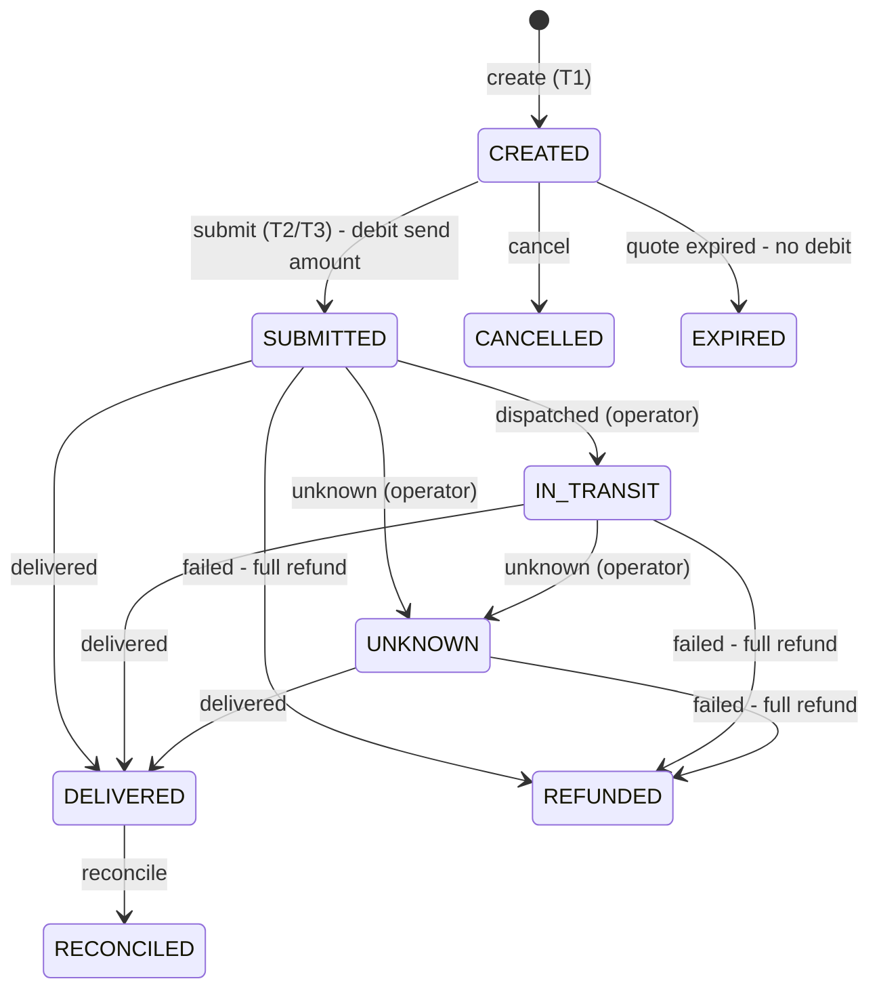
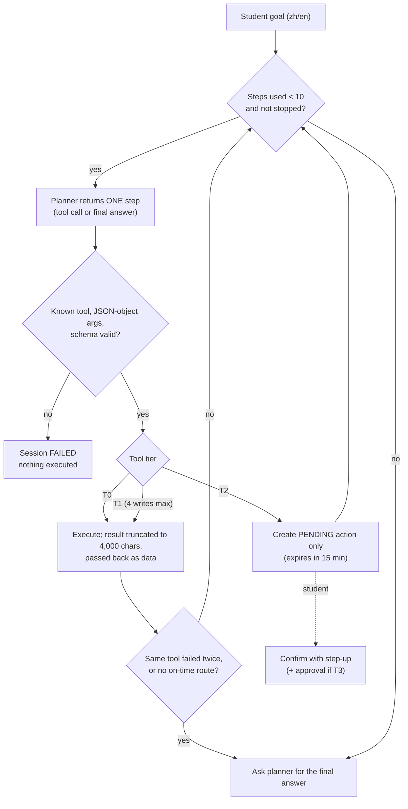

# Technical Overview

StudyFlow helps an international student plan money before and during a semester abroad. The student can hold several currencies, compare remittance routes, pay tuition and living costs to verified payees, build an on-time payment record, and ask an AI agent to prepare these steps. **All money is simulated**: there is no real bank, card or remittance rail. The controls around the money (pricing, permissions, limits, approvals and ledger constraints) are real and enforced by the server.

This document covers proposition C: multi-currency wallets, remittance, live FX, tiered permissions, the agent and credit building. It also covers the parts of the earlier B/C work that proposition C builds on. Security is covered in depth in [security-self-assessment.md](security-self-assessment.md); evaluation in [agent-evaluation.md](agent-evaluation.md).

---

## 1. Architecture

- **One backend.** Django is the only server. The C module (`studyflow-ai/`) is a Python package that Django imports, so both share users, wallets, ledger and database transactions. There is no second service to keep consistent.
- **Mock vs live.** Two independent switches control external calls. Both default to offline, so everything runs with no keys:
  - `STUDYFLOW_MODE=mock` uses rule-based planners and extractors; `live` calls the LLM gateway.
  - `STUDYFLOW_FX_LIVE=false` uses fixed FX rates; `true` calls Frankfurter.

  Gemini OCR is a third opt-in that is off by default. It needs operator attestations and per-file consent.
- **Every write goes through `CommandView`** (`finance/workflow_api.py`). In one database transaction it:
  1. authenticates the caller;
  2. checks the `Idempotency-Key` (a replay returns the stored response);
  3. takes a row lock on the user;
  4. runs the policy check for T2/T3 routes;
  5. runs the handler;
  6. writes an audit event.

  Any failure rolls back everything, including step-up token use.

### Directory map

| Path | Contents |
|---|---|
| `finance/` | Django app: wallets, FX, remittance, policy, credit, agent, lending (B), readiness, copilot, consumption |
| `finance/lending_core/` | B's pure loan calculations and contracts |
| `studyflow-ai/` | C package: agent planner and prompts, FX adapter, OCR, extraction, evaluation sets (`evals/`) |
| `config/` | Django settings, URLs, OpenAPI schema hooks |
| `auto_test/` | Django tests (481), including concurrency suites |
| `studyflow-ai/auto_test/` | C package tests |
| `scripts/` | `run_gates.py` (all checks), live verification scripts, PostgreSQL helpers |
| `evidence/` | Committed run logs and reports ([index](../evidence/README.md)) |
| `docs/` | Design and verification documents; `docs/api/` holds the API guide and reference |
| `legacy/`, `docs/legacy/` | Earlier prototype and notes; not part of the submission |

---

## 2. Server-side FX quoting

The client never supplies a rate. A quote is priced by the server from a corridor and a reference rate (`finance/fx_rates.py` `create_live_quote`).

1. **Reference (mid) rate.** The mid rate comes from Frankfurter, through the C adapter, which blends central-bank reference rates (ECB, Bank of Thailand, CFETS and others). In mock mode it comes from fixed fixtures. Snapshots are cached for 15 minutes. On a fetch failure the last snapshot is used, but a rate older than **7 days** is refused (`STALE_FX_RATE`). In live mode, fixture rates are never executable.
2. **Corridor.** There are 12 corridors (`finance/corridors.py`): CNY, USD and EUR → THB, and THB → CNY, each with express, standard and economy tiers. Each tier has a fixed fee, a percentage fee, an FX margin, min/max amounts and settlement days.
3. **Customer rate** = `mid × (1 − margin_bps / 10000)`, rounded **down** to 10 decimal places.
4. **Sender fee** = `fee_fixed + amount × fee_percent`, rounded half-up to the source currency's precision.
5. **Net received** = `(amount − sender_fee) × rate − receiver_fee`, rounded half-up to the target precision. Live quotes have a receiver fee of 0.
6. A quote is **valid for 10 minutes and can be used once**. It can only be used by its owner, and only for the amount it was priced for. Conversion and remittance both re-check that the corridor is still enabled and the amount is within range.

Example (live, 2026-10-07): CNY→THB express, 1,000 CNY, mid 5.0187, margin 60 bps, fee 30 + 0.5%.
- Fee = 30 + 1,000 × 0.005 = **35 CNY**
- Rate = 5.0187 × 0.994 = **4.98859 THB/CNY**
- Received = (1,000 − 35) × 4.98859 = **4,813.99 THB**

All 12 routes were checked by hand against live rates ([evidence/fx](../evidence/fx/verification-live-fx.json)).

A security review found that a client-entered rate could once be used to create money from nothing; this was fixed, and `test_manual_quote_exploit_is_rejected` guards against regression.

## 3. Remittance order state machine

Source: `TRANSITIONS` in `finance/remittance_orders.py`.
- Each transition checks the order's version and appends one row to an immutable status history (a database trigger blocks updates and deletes).
- **Money legs:**
  - `submit` debits the send amount from the source balance. For a THB source, the wallet must keep the student's reserve (`RESERVE_REQUIRED`).
  - `failed` refunds the full send amount and records a reason.
  - `delivered` credits the received amount to the student's own wallet when `recipient=SELF`; a payment to a beneficiary leaves the wallet untouched.

  The database allows **at most one leg of each kind per order** and enforces the sign of each leg.
- **Beneficiaries.** `recipient=BENEFICIARY` requires a verified payee, checked both when the order is created and again when it is submitted.
- **Callbacks** (`dispatched` / `delivered` / `failed` / `unknown`) are operator-only. Each is idempotent, so a duplicate callback is acknowledged without a second posting, and conflicting callbacks settle one way only.
- `REFUNDED` and `UNKNOWN` orders appear in the review queue. Delivered orders with a deadline, paid to a verified beneficiary, feed the credit record.

**Tuition** is not a separate module. It is paid either by a remittance with `purpose=tuition` to a verified payee, or by a readiness payment against a confirmed invoice ([consumption.md](consumption.md)).

## 4. Tiered permissions and limits (summary)

| Tier | Example | Requirement |
|---|---|---|
| T0 | any `GET` | logged in, own data only |
| T1 | quote, create order, request approval | owner |
| T2 | submit payment or remittance, convert, repay, within limits | **step-up**: password re-entry gives a token valid 5 minutes, single-use, bound to action, target, amount and currency |
| T3 | a T2 action above the per-transaction, daily or monthly limit | step-up **plus** approval by a different operator (separation of duties) |

Limits are kept per currency in the `PolicyLimit` table and multiplied by the credit multiplier (§5). Days and months follow real time in Bangkok. The check runs inside the command's transaction under the user lock, so concurrent requests cannot exceed a limit. The full control-by-control mapping to code and tests is in [security-self-assessment.md](security-self-assessment.md).

## 5. Credit level and limit multiplier

Source: `finance/credit.py`. The credit level is a simulated on-time record, not a credit score.

- **Evidence counted:**
  - loan instalments;
  - settled bill payments;
  - delivered remittance orders that have a deadline and go to a **verified** beneficiary.

  Self-transfers never count, so the level cannot be inflated cheaply.
- **Window.** Only the last **365 days** count, measured in **real** dates. Moving the demo clock forward can only make obligations overdue sooner; it can never age a late record out. Unresolved overdue items never age out.
- **Levels and multipliers:**

| Level | Rule (first match) | Limit multiplier |
|---|---|---:|
| AT_RISK | any overdue item, or 2 or more late records | 0.5 |
| GOOD | 6 or more on time and 0 late | 1.5 |
| FAIR | 3 or more on time and at most 1 late | 1.2 |
| BUILDING | otherwise | 1.0 |

- Snapshots are immutable. A signed statement (`django.core.signing`, valid 90 days) contains only summary fields, and anyone can verify it without logging in.

## 6. Ledger invariants

Source: `finance/wallets.py`, migrations `0015`–`0017`.

1. **One entry point.** Every balance change goes through `wallets.post()`. It locks the user row and the balance row, assigns a per-owner sequence number and writes one ledger entry.
2. **Non-negative balances.** A database `CHECK` constraint enforces this for both the home (THB) wallet and foreign `WalletBalance` rows.
3. **Ledger equals balance.** For each currency, the sum of ledger entries equals the balance. Randomized and mixed-sequence tests check this after every step.
4. **Immutability.** Ledger entries, conversions, remittance status history and agent steps cannot be updated or deleted.
5. **Exactly-once effects.** Idempotency keys, single-use quotes and step-up tokens, and per-order leg constraints mean that a retried or racing request never posts twice. Concurrency suites (`auto_test/test_*_concurrency.py`) run real parallel requests against PostgreSQL.

## 7. Agent loop and guardrails

Source: `finance/agent_runner.py`, `finance/agent_tools.py`, `studyflow-ai/src/studyflow_ai/agent/`.

| Guard | Value | Enforced by |
|---|---|---|
| Tool calls per session | 10 | `MAX_STEPS` |
| T1 writes per session | 4 | `MAX_WRITES` |
| Tool result size passed to the planner | 4,000 characters (`{"truncated": true, …}`) | `RESULT_CHARS` |
| Consecutive failures of the same tool | stop after 2 | `_must_stop` |
| Proposal lifetime | 15 minutes | `PENDING_SECONDS` |
| T2 execution by the agent | **none**: it can only propose | `_propose`; `confirm_pending` runs only for the student, under policy `agent.confirm` |
| Sessions per user | 30 per hour | `agent` throttle |

The planner prompt (`agent-1.1`) treats tool results, document text and CSV rows as untrusted data. Because the runner enforces the guards itself, they do not depend on the model obeying the prompt.

## 8. Internationalization

API error responses carry a stable `code` and a localized `message` in Chinese or English, negotiated from `Accept-Language`. A CI gate checks that the message catalogs are complete and compiled. The translations were produced by AI and have not yet been reviewed by a native speaker (risk M7).

## 9. Verification

| Check | Command | Latest result |
|---|---|---|
| All gates: Django and C tests, OpenAPI, lint, migrations, 6 HTTP demos, agent evaluation | `python scripts/run_gates.py` | 17/17 pass ([evidence/gates](../evidence/gates/summary.txt)) |
| Live FX pricing | see [verification-live-20261007.md](verification-live-20261007.md) | 4 pairs, 12 quotes match the formula |
| Live agent, frozen holdout | see [agent-evaluation.md](agent-evaluation.md) | 18/24, 0 unauthorized actions |
| CI | `.github/workflows/django.yml`, `c-module.yml` | runs on every push and pull request |

The holdout files `studyflow-ai/evals/copilot-holdout-v2/{manifest,protocol,review}.json` were hashed from a Windows checkout with CRLF line endings, but git stores them with LF. Their SHA-256 in `docs/independent-verification-summary.json` therefore matches the CRLF form. The project's own check (`test_blind_protocol_records_exact_runtime_code`) accepts the raw, LF and CRLF forms; a plain byte comparison on a Linux checkout will not match.
